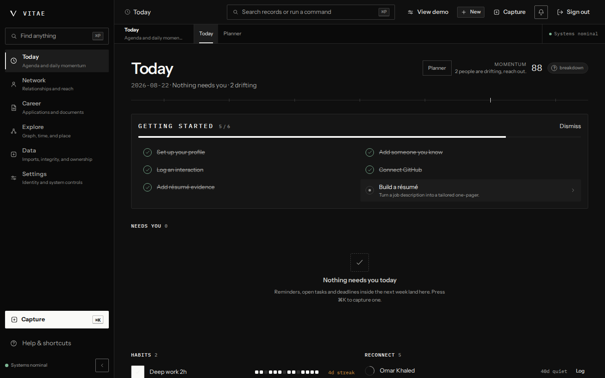
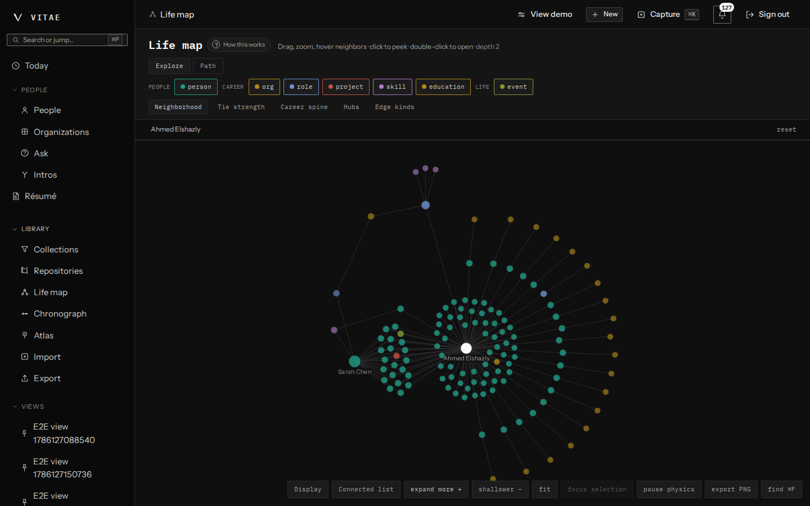

# Vitae

Vitae is a private system of record for a career. It keeps people, roles,
projects, conversations and evidence in one typed, versioned graph, then turns
that graph into tailored, ATS-safe résumés without calling a model at runtime.

**Live:** [vitae-eta.vercel.app](https://vitae-eta.vercel.app)



## Why I built it

A long career is hard to remember accurately. The proof of what you did sits in
old emails, project folders and other people's memories, and it is never in one
place when you need it (a job move, a promotion packet or a visa petition). The
tools that promise to help either want your whole history on their servers or
write your achievements for you.

I wanted the opposite, one graph that I own and can host myself, where every
claim on a résumé points back to the record that supports it, and where the
ranking that says whom to call next can explain itself.

## What it does

- **Capture.** Add linked records from a command bar (`⌘K`) or from full forms.
  Every record type has a structured form, so the command grammar is a shortcut,
  not a requirement.
- **Network.** See who you are drifting away from. The reconnect list ranks the
  ties you value most against how long it has been, and shows why each one is
  there.
- **Résumés and letters.** Paste a job description; Vitae parses it, scores your
  achievement records against it, and compiles a one-page LaTeX résumé or a
  cover letter from four templates. Every bullet cites the record it came from.
- **Explore.** Browse the graph as a life map, a timeline or an atlas, and find
  paths between people, organizations and projects.
- **Import and export.** Bring in LinkedIn archives, vCards, CSV and calendar
  files with deduplication and review. Export the whole graph in an open
  bundle format (its spec is in the repo) at any time.



## How it's built

| Layer | Choice |
|---|---|
| Client | React + Vite single-page app, shared UI package with design tokens |
| API | Express + TypeScript, route / service / repository layers, Zod at every boundary |
| Data | PostgreSQL |
| Domain | `packages/core`: pure algorithms with no database, HTTP or browser dependency |
| Documents | An isolated LaTeX build service compiles résumés and letters |
| Auth | Firebase Auth (emulated locally) |

A few parts I spent the most time on:

- **Deterministic résumé tailoring.** The job-description parser, keyword
  matching (Aho-Corasick), achievement scoring and the one-page fit loop are
  plain functions in `packages/core`. Each template ships a line model, so the
  fit loop can predict line breaks and trim to exactly one page before it
  compiles anything.
- **Explainable rankings.** Relationship strength, relevance and reconnect
  ordering come from closed-form formulas with published constants, and the screen
  shows the inputs behind every score.
- **Testing in layers.** Unit, property-based, metamorphic and golden tests for
  the core algorithms, mutation testing on top of them, API integration tests
  against a real Postgres, and Playwright end-to-end, visual and accessibility
  suites for the web app.
- **Release gates in CI.** Beyond lint and types, CI checks that no private
  hostnames or home paths ship, that the brand and design-token rules hold,
  and that the generated documentation still matches the code.

## Project layout

```text
apps/web          React and Vite single-page application
apps/api          Express REST API backed by PostgreSQL
packages/core     Shared Zod schemas and deterministic domain algorithms
packages/ui       Shared design tokens and interface primitives
packages/config   Validated environment configuration
services/buildsvc Isolated LaTeX compilation service
templates/        Résumé and letter templates with their line models
docs/             Architecture, ADRs, specs, runbooks and the documentation site
```

## Running it locally

Requirements: Node 22.23.0, pnpm 9.15.0, Docker, and Java 21 only when you run
the Firebase Auth emulator.

```bash
corepack enable
corepack prepare pnpm@9.15.0 --activate
cp .env.example .env
pnpm install --frozen-lockfile

# In separate terminals:
pnpm dev:db
pnpm dev:emulators
pnpm dev

# Optional. Required when exercising PDF compilation.
docker compose up -d buildsvc

# Load fully fictional demo records.
pnpm seed
```

Open <http://localhost:5173>. The local template turns on a development-only
sign-in shortcut. Disable it outside local development.

## Documentation

| Topic | Location |
| --- | --- |
| System design | [Architecture](docs/ARCHITECTURE.md) |
| API surface | [API reference](docs/api/README.md) and [OpenAPI](docs/api/openapi.json) |
| Configuration and deployment | [Deployment guide](docs/DEPLOYMENT.md) |
| Operations | [Runbooks](docs/runbooks/README.md) |
| Testing | [Testing guide](docs/testing/README.md) |
| Data handling | [Privacy and sample data](docs/PRIVACY.md) |
| Hosted Cloud release | [Cloud launch guide](docs/CLOUD-LAUNCH.md) |
| Security reporting | [Security policy](SECURITY.md) |
| Compatibility and releases | [Release policy](RELEASE.md) and [changelog](CHANGELOG.md) |
| Contributing | [Contributor guide](CONTRIBUTING.md) |

## Security and data

Use `.env.example` as a names-only template. Do not commit credentials, real
exports or personal records. The repository contains fictional fixtures only.
Report vulnerabilities through the process in [SECURITY.md](SECURITY.md).

## License

Vitae is licensed under the [Apache License 2.0](LICENSE). See [NOTICE](NOTICE)
for attribution and [AUTHORS](AUTHORS) for who wrote it.
