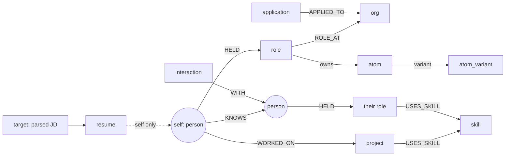

# Vitae Architecture

This document explains how Vitae is built and why. It is the map a new engineer
(or future-you) reads before touching the code. The authoritative requirements
are in [`docs/specs/srs.md`](specs/srs.md).

## 1. The one-paragraph version

Vitae stores a person's whole life and career as a typed graph: **nodes**
(people, roles, projects, skills, interactions…) and first-class **edges**
(KNOWS, WORKED_ON, USES_SKILL…), versioned with full provenance. From that graph
it answers two questions a technical career runs on: *"who should I call?"* (an
explainable CRM ranking) and *"what do I say about myself for this job?"* (a
deterministic, ATS-safe, one-page LaTeX résumé). Every "intelligent" behaviour is
a closed-form algorithm with visible evidence. **No AI, no LLMs**.

## 2. Monorepo layout

```
packages/core     Zod schemas (the data model) + the §10.7 algorithms (the science).
                  Pure TypeScript, no I/O. Imported by BOTH api and web.
packages/ui       Design system: tokens, primitives, entity glyphs.
packages/config   Zod-validated environment schema + shared tsconfig/eslint.
apps/api          Express REST API (/api/v1) over Postgres.
apps/web          React 18 + Vite SPA.
services/buildsvc Dockerized Tectonic + poppler (LaTeX → PDF), HMAC-gated.
templates/*       LaTeX résumé templates (Onyx, Argon) + line models.
```

The critical design choice is that **the intelligence lives in `packages/core`**,
independent of Postgres, Express, and React. That means the tie-strength model,
the JD parser, and the résumé selector are unit-tested in isolation and reused
verbatim on both client and server. See [`docs/adr/0002-core-shared-package.md`](adr/0002-core-shared-package.md).

## 3. Stack decision (Postgres data plane, Firebase Auth)

The SRS specifies Postgres/Neon for relationship ranking, full-text search,
revisions, and `pg_dump` export. An earlier build overrode that to Firestore
([ADR 0001](adr/0001-firestore-over-postgres.md)). Read amplification then made
the free tier unusable and blocked nightly backups, so the data plane moved back
to **Postgres** ([ADR 0005](adr/0005-postgres-over-firestore.md)). Firebase Auth
and Cloudinary stay.

| Concern | Current approach |
|---|---|
| Persistent graph | Postgres (`data jsonb` + `GENERATED ALWAYS` columns; ADR 0005) |
| Who-to-call ranking | In-memory graph computation in `services/crm.ts` over `@vitae/core` (single-user scale; SQL joins available for later) |
| Full-text search | FlexSearch index built from live nodes (`db/search-index.ts`); Postgres FTS deferred |
| Recursive graph traversal | Personalized PageRank + adjacency walks in `@vitae/core` |
| Archival / restore | JSONL + Markdown-vault export ZIP (`services/export.ts`); RDS PITR for short windows |
| Auth | Firebase Auth (emulator locally; Google provider in prod) |
| File storage | Cloudinary via `StorageAdapter` |

At the SRS scale ceiling (≤50k nodes, ≤250k edges) the in-memory ranking path
stays within budget. Records are stored whole as `jsonb`; never write generated
columns directly.

## 4. Data model

Every record shares a **common envelope** (`packages/core/src/schema/envelope.ts`):
`id, type, title, subtitle, props, notes_md, dates, status, pinned, sensitivity,
source, source_ref, confidence, captured_at, created_at, updated_at, archived_at,
deleted_at`. Type-specific fields live in `props`, validated by a **per-type Zod
schema** (`node-props.ts`). Edges carry their own `props` too: the relationship
*is* a record (`edge-props.ts`), richest for `KNOWS`.

Primary tables mirror the former collections: `nodes`, `edges`, `revisions`,
`atoms`, `atom_variants`, `atom_skills`, `targets`, `resumes`, `reminders`,
`tags`, `taggings`, `attachments`, `merges`, `imports`, `saved_views`, and peers.
Per-request data space (`x-vitae-space: demo`) is a `space` column in every
primary key (see `apps/api/src/db/space.ts`).

`HELD`, `WORKED_ON`, `EARNED`, `ATTENDED`, `AUTHORED` and `COMPLETED` are
**subject edges**: they say whose the record is. Other people in the graph own
their own records the same way, and a skill node is shared by both.



### Ownership: whose record is this (ADR 0004)

The graph holds **several people's records**, not just the owner's: imports bring
in other people's roles, degrees and publications. So "every node of this type"
is *not* "every node of this type that is mine", and a read model that confuses
the two puts other people's credentials on the user's résumé.

Types that are meaningless without a person declare their owning edge in
`NODE_FORM_DESCRIPTORS[type].subject`: `HELD person→role`, `EARNED
person→certification|award`, `ATTENDED person→education`, `AUTHORED
person→publication|repository|post`, `WORKED_ON person→project`, `COMPLETED
person→course`. Organizations, skills and locations declare none: they are shared
vocabulary and belong to nobody.

| Layer | What it gives you |
|---|---|
| `packages/core/src/forms/subjects.ts` | `subjectEdgeFor`, `isSubjectBearing`, `subjectAssignment`: **derived** from the form descriptors so the two cannot drift |
| `apps/api/src/services/subjects.ts` | `buildOwnerIndex(graph)`: one pass over the edges → `ownerOf` / `recordsOf` / `unowned` / `contested`; plus `skillIdsFor` and the reserved owner |
| `apps/api/src/services/profile.ts` | `personProfileFrom(graph, personId)`: any person's own records, grouped as a CV reads |

Two invariants:

- **Ownership is total.** A subject-bearing record with no subject edge belongs
  to the reserved anonymous **"Unattributed"** person (`props.is_placeholder`),
  never implicitly to the user. "Not mine" and "nobody said" must not collapse.
- **The résumé is single-subject.** `buildFullModel` scopes every section to the
  `is_self` anchor, and renders an *empty* model when there is no anchor. Every
  other surface shows the whole graph and labels the owner instead.

`pnpm audit:graph` reports `unowned-record` / `contested-record` and a
records-by-owner table; `backfill:subjects` attributes orphans (to the
placeholder by default, `--to-self` to claim them).

### Versioning and recovery

Every mutation writes an append-only `revisions` row (`{op, snapshot, diff,
source, at}`) inside the same transaction as the write. Deletes are soft
(`deleted_at`); Trash restores them for 30 days. This is the audit log and the
undo substrate.

## 5. The intelligence layer (`packages/core/src/algorithms`)

Each module implements one deterministic method as a pure, tested function:

| Module | Method | SRS |
|---|---|---|
| `tie-strength.ts` | Hawkes exponential-kernel intensity + adaptive decay | §10.7.1 |
| `reconnect.ts` | Spaced-repetition review-intensity ordering | §10.7.2 |
| `who-to-call.ts` + `pagerank.ts` | Expert-finding: BM25 evidence + Personalized PageRank | §10.7.3 |
| `jd-parser.ts` + `aho-corasick.ts` | BM25F structured-document term weighting | §10.7.4 |
| `atom-scoring.ts` + `selection.ts` | Budgeted submodular maximization (knapsack) | §10.7.5 |
| `dedup.ts` | Fellegi-Sunter probabilistic record linkage | §10.7.6 |
| `line-model.ts` | Template line budget → live page meter | §6.6 |
| `latex-escape.ts` | Security-critical LaTeX sanitization (fuzz-tested) | §8.4 |
| `capture-grammar.ts` | The ⌘K quick-add mini-language | §5.1 |
| `filter-grammar.ts` | The search filter AST | FR-SRCH-002 |

Every score returned by these functions **decomposes exactly** into the factor
chips the UI shows. Explainability is a correctness property, not a feature.

## 6. Request lifecycle

```mermaid
flowchart TB
  subgraph web [apps/web · React SPA]
    UI[screens] --> QC[TanStack Query] --> AC[api client]
  end
  AC -- cookie session --> MW[authGate: default-deny + owner check]
  MW --> R[/api/v1 routers/]
  R --> SVC[services: capture · crm · resume · export]
  SVC --> CORE[[@vitae/core algorithms]]
  SVC --> REPO[repository → Postgres]
  R -- HMAC --> BUILD[buildsvc: Tectonic]
  SVC --> CLD[(Cloudinary)]
```

Auth is **default-deny** (`middleware/auth.ts`): only `/health` and the
dev-login/logout endpoints are public; everything else requires the owner's
verified session (Firebase ID token or dev-login JWT) whose email equals
`OWNER_EMAIL`. The résumé build service is called server-side only, HMAC-signed
(`services/buildsvc-client.ts`), and degrades gracefully to a `.tex` download when
offline.

## 7. Security posture

- Default-deny middleware; neutral 401s that never reveal the allow-list.
- Helmet + per-request CSP nonce (`middleware/security.ts`).
- The LaTeX **escape layer** sanitizes all user content before it reaches TeX,
  proven by a property-based fuzz suite (2000+ random Unicode + metacharacter
  cases must always produce safe output).
- Build service: HMAC-signed, `--untrusted` (no shell-escape), per-request
  tmp workdir, no egress, non-root.
- Cloudinary uploads are content-addressed (SHA-256) and delivered privately via
  short-lived signed URLs.

## 8. Where to change things

| I want to… | Go to… |
|---|---|
| Add a node type | `packages/core/src/types.ts` + `schema/node-props.ts` |
| Tune a ranking weight | `packages/core/src/algorithms/constants.ts` |
| Add an API endpoint | `apps/api/src/routes/v1/*` + mount in `index.ts` |
| Add a screen | `apps/web/src/routes/*` + a `<Route>` in `App.tsx` |
| Change a résumé template | `templates/<key>/main.tex` + `line-model.json` |
| Restyle a primitive | `packages/ui/src/styles/components.css` |
